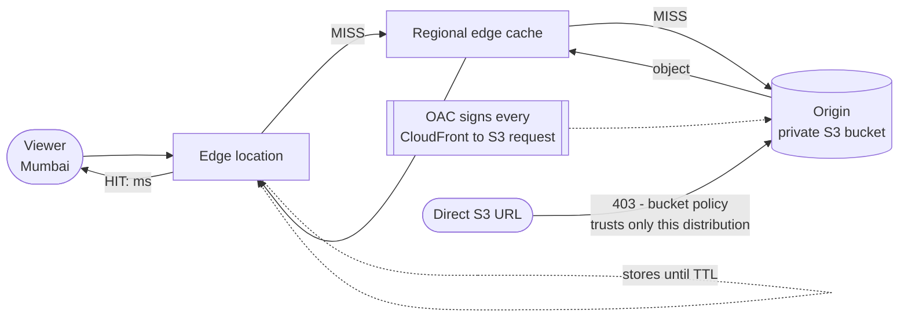

# 11 – CloudFront (CDN)

AWS's content delivery network. Caches your content at edge locations worldwide so users fetch it from nearby instead of from your origin — and, less obviously, accelerates even *uncacheable* traffic by pulling it onto the AWS backbone at the edge.

> [!info] Exam TL;DR
> - **Cache miss → fetch from origin → store at the edge → serve hits until the TTL expires.** A **regional edge cache** usually sits between the edge and your origin, checked on a miss before the origin is. Three things skip it and go straight to the origin: **proxy methods** (`PUT`, `POST`, `PATCH`, `OPTIONS`, `DELETE`), **dynamic requests** (as determined at request time), and an **S3 origin whose optimal regional edge cache is in the same Region as the bucket**.
> - **Not just static content.** Dynamic, uncacheable requests still benefit, because they enter the AWS backbone at the edge instead of crossing the public internet.
> - **OAC (Origin Access Control)** locks an S3 origin so CloudFront is the only way in — Block Public Access stays **fully on**. OAC is current; **OAI is legacy**. The bucket policy trusts `cloudfront.amazonaws.com` **with an `AWS:SourceArn` condition pinning your distribution** — the confused-deputy defence again.
> - **An S3 *website* endpoint is a custom origin and cannot use OAC or OAI at all.** OAC needs the **S3 REST endpoint** (`bucket.s3.region.amazonaws.com`).
> - **Versioned filenames beat invalidation.** Invalidation is the emergency tool: **1,000 paths/month free** per account, `/*` counts as **one path**.
> - **An ACM certificate for CloudFront must live in `us-east-1`**, no matter where the origin is.
> - **CloudFront Functions** (JS, sub-ms, viewer events only, no network) vs **Lambda@Edge** (Node/Python, up to 30 s, all four events, network + request body).
> - **CloudFront vs Global Accelerator:** CloudFront caches HTTP at the edge. Global Accelerator gives **two static anycast IPs**, works at **TCP/UDP**, **caches nothing**, and fails over **without DNS or TTL** because the IPs never change.

## What problem does this solve?

Distance is the problem. A request from Mumbai to a server in Virginia crosses the public internet twice — once out, once back — and every hop adds latency. Nothing about your code is slow. The map is slow.

One fix is to run copies of your server in twenty countries. That is expensive, and now there are twenty things to deploy to.

CloudFront does the cheap version. AWS already operates **edge locations** worldwide. CloudFront keeps your real server — the **origin** — in one place, and puts *copies of the content* at the edges near your users. The first person in Mumbai to ask pays for the long trip. Everyone after them gets a local answer.

Then there is the second, quieter benefit, and it is the one people miss. Content that *cannot* be cached at all — a logged-in dashboard, an API response that differs for every user — still gets faster. The request enters the **AWS global backbone** at the nearest edge instead of traversing the public internet end to end. That is why putting CloudFront in front of a dynamic API is a real optimisation and not just a static-asset trick.

> In one line: a copy of your content near the user, and AWS's own network for everything that can't be copied.

## How it actually works

### Two caches sit between the viewer and your origin

Walk a real request.

A viewer in Mumbai asks for an object. The nearest edge location doesn't have it — that's a **miss**. Before going all the way back to your origin, CloudFront checks a **regional edge cache**, a second cache that sits between the edges and the origin. Only if that misses too does the origin get touched. Three cases bypass it entirely: the **proxy methods** (`PUT`, `POST`, `PATCH`, `OPTIONS`, `DELETE`), requests AWS classes as **dynamic** at request time, and an **S3 origin that already sits in the same Region** as the regional edge cache that would have been used. The object then travels back out, is stored at the edge, and is served.

Every later request at that edge is a **hit**, answered locally in milliseconds, until the **TTL** expires and CloudFront revalidates.

The practical consequence of the middle layer: *a miss at the edge is not automatically a trip to your origin.* If you are reasoning about origin load, the edge miss rate is not the number you want.

You can watch the whole thing in the response headers, which is the fastest way to check your mental model against reality:

| Header | Tells you |
|---|---|
| `X-Cache: Hit from cloudfront` / `Miss from cloudfront` | whether this request was served from cache |
| `Age` | how many seconds the cached copy has been sitting there |
| `X-Amz-Cf-Pop` | which edge location served you |
| `X-Amz-Cf-Id` | the id to correlate with logs |

> In one line: edge first, regional edge cache second, origin last — a miss at the edge doesn't mean a trip home.

### Why the S3 bucket policy needs a condition to actually be safe

The goal: the bucket is completely private — Block Public Access fully on — and CloudFront is the only way in.

The mechanism is **Origin Access Control**. OAC signs every CloudFront→S3 request, and the bucket policy grants `s3:GetObject` to the service principal `cloudfront.amazonaws.com`. (OAC is the current tool; **OAI is legacy**.) So far this reads like ordinary IAM.

Here is the part that bites. `cloudfront.amazonaws.com` is **the same principal for every AWS customer on earth**. It identifies the *service*, never the *customer*. A bucket policy that trusts it and stops there has said "any CloudFront distribution may read this bucket."

And it works. The site serves. Direct S3 URLs still return 403 to anonymous users. The tests pass. But anyone who learns your bucket name can point **their own** distribution at it and serve your content on their own domain — read from you, billed to them.

That is what the `AWS:SourceArn` condition pinning your distribution's ARN is for. Note carefully what it does *not* do: it is not what makes your distribution work. It is what stops everybody else's. This is the confused-deputy defence, and its whole difficulty is that omitting it breaks nothing visible.

One hard constraint sits on top of all this: OAC needs the **S3 REST endpoint** (`bucket.s3.region.amazonaws.com`). An S3 bucket configured as a **website endpoint** is treated as a *custom* origin, and custom origins support **neither OAC nor OAI**. If the requirement is "private bucket," you take the REST endpoint and give up S3's website features — index documents on subfolders, S3 redirect rules — replacing them with CloudFront's **Default root object** and custom error pages.

> In one line: the service principal names the service, never the customer — the `SourceArn` condition is the part that names you.

### Why AWS tells you not to invalidate

You deployed new CSS. Until the TTL on that object expires, the edges keep serving the old file. The obvious move is **invalidation**: tell CloudFront to drop that path. It's cheap — the first **1,000 paths per month per account** are free, and a path containing `*` counts as **one path** no matter how many files it clears.

AWS still recommends you don't design around it, and the reason is worth holding on to: **invalidation only clears caches AWS owns.** It cannot reach the viewer's browser cache, and it cannot reach a corporate proxy. So some users keep seeing the stale file regardless, and now your access logs are ambiguous too — the same URL meant two different files at two different times.

The alternative flips the problem around. Put a hash **in the filename**. A new build produces a new name, and a new name is a **new cache key** — so there is nothing stale to clear, because nothing was ever overwritten. You also get clean rollbacks, readable logs, and users mid-session keep working off the old asset instead of receiving a half-updated page.

That leads to the two-tier pattern: `index.html` gets a **short TTL** (60 s) because it is tiny and it is the one file that must change quickly; `/static/app.a1b2c3.css` gets a **one-year TTL** because its name already guarantees uniqueness.

Invalidation isn't wrong — it's the emergency tool, for when you shipped a genuine mistake.

> In one line: change the name, not the cache — invalidation can't reach caches you don't own.

### Why the certificate has to be in one specific Region

An ACM certificate used for **viewer↔CloudFront** HTTPS must be requested or imported in **`us-east-1`**. Not the origin's Region. Not your Region. Always that one.

The reason it catches people is the failure mode. A perfectly valid certificate sitting in `eu-west-1` doesn't throw an error explaining the rule — it simply **never appears** in the distribution's certificate list. You go looking for a bug in your ACM setup, and there isn't one.

There is exactly one exception, and it is on the other leg of the journey: for **CloudFront↔origin** HTTPS with an **ELB** origin, the certificate may live in any Region. Different leg, different rule. That leg has its own failure to recognise too — if no domain in the origin's certificate matches the origin domain name, viewers get **502 Bad Gateway**.

> In one line: the certificate viewers see lives in `us-east-1` whatever the origin does; the origin-facing one is the exception.

### Why Global Accelerator fails over faster than DNS can

These two look interchangeable in a question. Both "make it faster globally," both ride the AWS edge network. They are not the same tool.

**CloudFront caches HTTP content.** **Global Accelerator caches nothing** — it routes **any TCP/UDP** traffic over the AWS backbone to the nearest healthy Region, with **NLB, ALB, EC2 or an Elastic IP** as endpoints.

The discriminator that actually decides exam questions is failover speed, and it comes from one detail: Global Accelerator gives you **two static anycast IPs** (four dual-stack) and **those IPs don't change while the accelerator exists**. Failover normally means publishing a different DNS answer, and you are then stuck waiting for every resolver's cached copy to expire — [[10-route53]] failover is no faster than roughly `(interval × threshold) + TTL`. With Global Accelerator there is nothing for a resolver to cache in the first place, because the address is identical before and after. The switch happens inside AWS's network. No DNS, no TTL.

CloudFront has its own failover, and it is worth not confusing with either of the above: an **origin group** holds a primary and a secondary origin and switches when the primary returns one of the HTTP status codes you nominated. Per request, inside CloudFront, no DNS involved — but only for **`GET`, `HEAD` and `OPTIONS`** viewer requests. A `POST` or `PUT` never fails over, which quietly rules origin groups out of any write-path scenario.

> In one line: CloudFront caches, Global Accelerator doesn't — its trick is IPs that never change, so DNS never has to catch up.

## Architecture diagram

## Key facts, limits & pricing

- **Global Accelerator is not a CDN and caches nothing.** A *standard* accelerator gives you **two static anycast IPv4 addresses** (four for dual-stack) advertised from the **AWS edge network**, then carries the session **over the AWS global network** to the optimal regional endpoint by *"health, client location, and policies that you configure"*. Endpoints can be **NLB, ALB, EC2 instances or Elastic IPs**, in one Region or several. Because it accelerates the **network path** rather than caching bytes, it is the answer for **dynamic, non-cacheable** traffic — a real-time API, gaming, VoIP, IoT/MQTT, non-HTTP protocols — including an API served from a **single Region**, where a CDN has nothing to cache. *(Verified 2026-10-01.)*
- **Traffic dial (Global Accelerator):** a percentage on each *standard* endpoint group (one per Region) controlling how much traffic is directed to that group; default **100%**. AWS names it as the tool for *"performance testing or blue/green deployment testing for new releases across different AWS Regions"*. Because clients keep targeting the same static anycast IPs, AWS says you can *"run blue/green deployment, and do A/B testing without having to update the IP addresses in your client applications"*. A changed dial applies to **new connections only**; existing ones are not terminated. Endpoint **weights** (within a group) are a separate control. *(Verified 2026-10-14.)*
- **Bring your own IP (Global Accelerator):** the two static IPs are AWS-assigned **by default**. The exception is BYOIP: you can use a public **IPv4 /24 you own** as the accelerator's entry point — up to **two** ranges per account, IPv4 only. Bring one range and Global Accelerator supplies the second IP from Amazon's pool. Bring **two** and AWS says *"you can assign one IP address from each range to your accelerator"* — each range goes to a different network zone. So a company already advertising two IPs from two /24s **keeps them** by bringing both ranges, instead of taking new anycast IPs. A range brought for one AWS service can't be reused by another. *(Verified 2026-10-14; two-range case 2026-10-16.)*

- **Origins:** an S3 bucket (REST endpoint), an S3 bucket configured as a **website endpoint** (treated as a *custom* origin), S3 Access Points, S3 Object Lambda, S3 Multi-Region Access Points, **MediaPackage**, **ALB**, **NLB**, **EC2**, **Lambda function URLs**, **API Gateway**, and **any public HTTP(S) server, including on-premises**.
- **VPC origins** let an **ALB, NLB or EC2 instance in a private subnet** ([[04-alb-asg]]) be an origin without any public internet exposure — the modern way to keep the load balancer private while still fronting it with CloudFront.
- **Origin groups** provide CloudFront's own failover: a primary and a secondary origin, switching when the primary returns an HTTP status code you nominated for failover (pick from **400, 403, 404, 416, 429, 500, 502, 503, 504**). A **failed connection** counts only if **503** is configured; a **timeout** only if **504** is. (Distinct from Route 53 failover — no DNS involved.)
- **Custom error responses** — when the origin returns an error status, CloudFront can return a **custom error page** instead. AWS recommends keeping those pages in an **S3 bucket, not on the same origin**: *"If you store the custom error pages on the same origin as your website or application, and the origin starts to return 5xx errors, CloudFront can't get the custom error pages because the origin server is unavailable."* Errors are cached **10 seconds** by default (the **Error Caching Minimum TTL** changes it). So "show a static error page when the site is down" → CloudFront in front of the ALB + a custom error page in S3. *(Verified 2026-10-15.)*
- **The origin-group restriction that decides exam questions:** CloudFront fails over "only when the HTTP method of the viewer request is `GET`, `HEAD`, or `OPTIONS`. CloudFront does not fail over when the viewer sends a different HTTP method (for example `POST`, `PUT`, and so on)." So for a **write path or an API**, origin groups are the *wrong* answer. There is a second gotcha: failover won't happen at all if `OPTIONS` isn't among the cache behaviour's **cached HTTP methods**.
- **Origin-group timing:** by default CloudFront spends up to **30 seconds** on the primary (3 connection attempts × 10 s) before failing over. Tunable: connection timeout **1–10 s**, connection attempts **1–3**, origin response timeout default **30 s** and settable **1–120 s**. And there is no stickiness — "CloudFront routes all incoming requests to the primary origin, even when a previous request failed over to the secondary origin."
- **OAC vs OAI:** AWS recommends **OAC**. OAI does **not** support all Regions (including opt-in Regions launched after Dec 2022/Jan 2023), **SSE-KMS**, or dynamic `PUT`/`POST`/`DELETE`. Migration path: allow both principals in the bucket policy, switch the distribution, then remove the OAI statement.
- **OAC requirements:** S3 **Object Ownership** must be *Bucket owner enforced* (the default for new buckets). With the origin access control's signing behaviour set to **Sign requests (always)** — `SigningBehavior: always` in the API — CloudFront→S3 is **always HTTPS**. For **SSE-KMS** objects you must also add CloudFront to the **KMS key policy**, with the same `AWS:SourceArn` condition.
- **Invalidation:** the first **1,000 invalidation paths per month per AWS account** (across all distributions) are free; a path containing `*` counts as **one path** however many files it clears, and tag-based invalidations draw on the same allowance. AWS explicitly recommends **versioned file names instead**, because invalidation can't reach a user's browser cache or a corporate proxy — and because versioning gives you clean rollbacks and readable access logs.
- **HTTPS / certificates:** an ACM certificate used for **viewer↔CloudFront** HTTPS must be requested or imported in **`us-east-1`**. (Exception: for **CloudFront↔origin** HTTPS with an **ELB** origin, the certificate may be in any Region.) RSA 1024–4096-bit (ACM issues up to 2048) or ECDSA 256/384-bit. If no domain in the origin's certificate matches the origin domain name, viewers get **502 Bad Gateway**.
- **Price classes** cap how far afield your content is served from, cheapest first. In AWS's own words: **`PriceClass_100`** = *"USA, Canada, Europe, & Israel"*; **`PriceClass_200`** = PriceClass_100 plus *"South Africa, Kenya, Middle East, Japan, Singapore, South Korea, Taiwan, Hong Kong, Philippines, India, Indonesia, Thailand, Malaysia, Vietnam, Nigeria, Egypt, & Türkiye"*; **`PriceClass_All`** = *"All locations"*, and it is the **default**. Viewers in or near excluded regions *"may encounter slower performance"*; the edge that served a request shows in the `X-Amz-Cf-Pop` header. AWS names **USA and Canada**, not "North America". Source caveat: the CloudFront `PriceClass` docs page is retired; this geography comes from the **AWS CDK API reference** (first-party, but a library reference, which itself defers to the pricing page). *(Verified 2026-10-14.)*
- **Data transfer from your AWS origin to CloudFront is waived** — AWS's words: "Data transfer between CloudFront and your AWS origins is automatically waived when serving traffic through CloudFront." Beyond that there are now **two** pricing models, and the note used to describe only the second: **flat-rate monthly plans** (**$0 / $15 / $200 / $1,000**) that bundle CDN, WAF, DDoS protection, DNS, a TLS certificate, logging and edge compute with **no overage charges**; or **pay-as-you-go**, where you are "billed separately for each service based on your actual usage" — classic per-GB data transfer out plus per-request charges. *(Verified 2026-10-07.)*
- **Response headers worth knowing:** `X-Cache: Hit from cloudfront` / `Miss from cloudfront`, `Age` (seconds cached), `X-Amz-Cf-Pop` (which edge served you), `X-Amz-Cf-Id` (log correlation).
- **Geo restriction** allows or blocks whole **countries** at the edge, and it applies to the **entire distribution**, not per path (console: *Allow list* / *Block list*; the API still uses `whitelist` / `blacklist`). A blocked viewer gets **403 Forbidden**. Need finer than country granularity, or restriction on only part of the content? That is a third-party geolocation service plus signed URLs, not this feature. Distinct from Route 53 **geolocation routing**, which chooses *where to send* rather than *whether to allow*. AWS states there is **no additional charge for configuring geographic restrictions** — note the wording: no incremental fee for the *feature*, while ordinary CloudFront request and data-transfer pricing is untouched. Two behaviours worth more than the price: accuracy is stated as **99.8%**, and it **fails open** — *"If CloudFront can't determine a user's location, CloudFront serves the content that the user has requested."* There is also a carve-out: geographic restrictions **do not apply to certificate-validation requests** for CloudFront managed certificates — requests to `/.well-known/pki-validation/` are exempt so CAs can validate from multiple geographic vantage points. AWS adds a warning worth carrying into production: if you use **WAF** on the distribution, make sure your rules (**bot control included**) don't block that path either, or certificate issuance and renewal fail.
- Integrates with **AWS WAF** and **Shield** (Standard is automatic and free; Advanced is paid) for DDoS and application-layer protection at the edge.

> [!warning] Trap — "geo restriction will guarantee the content never leaves these countries"
> Two reasons it will not. It is **99.8%** accurate, and when CloudFront **cannot** determine a location it **serves the content** rather than blocking it — *"CloudFront serves the content that the user has requested."* A compliance requirement phrased as "must not be accessible from X under any circumstances" is therefore not satisfied by this feature alone; that is signed URLs/cookies or an authorisation layer, with geo restriction as defence in depth. The free-ness is also narrower than it sounds: **no additional charge** covers CloudFront's own country-level allow/block list, not the third-party geolocation service (Digital Element, MaxMind) you would need for sub-country granularity, which is a separately paid external account.
- **Keep viewers from bypassing CloudFront to the ALB:** (1) CloudFront adds a secret **custom HTTP header** that an ALB listener rule requires; (2) the ALB security group allows only the **CloudFront managed prefix list**, which *"prevents non-CloudFront traffic from reaching your origin"* — and *"CloudFront maintains the managed prefix list"*; (3) **VPC origins** put the ALB in a private subnet. OAI is S3-only, so it is not the answer here. *(Verified 2026-10-15.)*
- **Cache behaviours route by path.** Each behaviour has a path pattern (e.g. `images/*.jpg`) and *"the origin to which you want CloudFront to forward your requests"* — so one distribution can send images, API calls and video to different origins. *"The default cache behavior is always the last to be processed. Other cache behaviors are processed in the order in which they're listed"*. **Field-level encryption** encrypts specific POST fields (*"up to 10 data fields"*) at the edge with your public key — *"Field-level encryption adds an additional layer of security"* beyond HTTPS. Price class only picks edge locations; it never picks an origin. *(Verified 2026-10-15.)*

## Comparisons

### CloudFront vs S3 Transfer Acceleration vs Global Accelerator

|   | **CloudFront** | **S3 Transfer Acceleration** | **Global Accelerator** |
|---|---|---|---|
| What it does | caches HTTP content at edges | speeds long-distance S3 transfers via an edge + an optimized network path — AWS's definition is bidirectional, its stated use cases are all **uploads** | routes **any TCP/UDP** over the AWS backbone to the nearest healthy Region |
| Caches? | ✅ | ❌ | ❌ |
| Protocols | HTTP/HTTPS | S3 API | **TCP / UDP** |
| Static IPs | ❌ (DNS name) | ❌ | ✅ **two static anycast IPs** (four dual-stack) |
| Failover speed | origin groups, per request | n/a | **instant — no DNS, no TTL** |
| Endpoints | origins | one bucket | **NLB, ALB, EC2, Elastic IP** |
| Reach for it when | cacheable web content, global static/dynamic sites | large uploads to S3 from far away | gaming, VoIP, IoT/MQTT, non-HTTP, static IPs required, sub-minute regional failover |

*The Global Accelerator discriminator that matters: the IPs **don't change while the accelerator exists**, so there is nothing for a resolver to cache. Compare with [[10-route53]] failover, which is no faster than roughly `(interval × threshold) + TTL`.*

### Route 53 latency-based routing vs Global Accelerator

|   | **Route 53 latency routing** ([[10-route53]]) | **Global Accelerator** |
|---|---|---|
| What it changes | the **DNS answer** — picks the lowest-latency Region's record and returns its value, *"such as the IP address for a web server"* | the **path** — anycast to the closest edge, then *"over the AWS global network"* to the closest regional endpoint |
| Entry point clients hold | whatever IP the record returns, which can change | **two static anycast IPs** that don't change |
| How fast a change reaches clients | DNS caching — AWS: *"you don't know how long it will take before all of your users receive updated IP addresses"* | *"Change propagation takes a matter of seconds"* |
| Pick it when | plain multi-Region HTTP steering with no static-IP, non-HTTP or seconds-scale requirement | the stem demands **static IPs**, a **non-HTTP protocol**, or **seconds-scale failover** |

*AWS does not rank the two for a plain "lowest latency" stem — pick on the extra requirement (static IPs, non-HTTP, seconds-scale failover). The propagation row is from the Global Accelerator **FAQ**, not the docs site. (Verified 2026-10-14.)*

### CloudFront Functions vs Lambda@Edge

|   | **CloudFront Functions** | **Lambda@Edge** |
|---|---|---|
| Language | JavaScript (ECMAScript 5.1 compliant), or **JavaScript runtime 2.0** | Node.js and Python |
| Events | **viewer request / viewer response only** | viewer request/response **+ origin request/response** |
| Duration | **sub-millisecond** | up to **30 seconds** |
| Memory | 2 MB | 128 MB (viewer) / 10 GB (origin) |
| Code + libraries | 10 KB | 50 MB |
| Network access | ❌ | ✅ |
| File system / request **body** | ❌ | ✅ |
| Scale | millions of req/sec | 10,000 req/sec per Region |
| Geolocation & device data | ✅ | ❌ at viewer request/response; ✅ at origin request/response |
| Use for | cache-key normalisation, header manipulation, URL rewrites/redirects, JWT validation | anything needing the SDK, third-party libraries, network calls, or the request body |

### Signed URLs vs signed cookies (private content)

|   | Signed URL | Signed cookies |
|---|---|---|
| Grants access to | **one individual file** | **multiple files** (a whole section, all HLS segments) |
| Use when | the client can't handle cookies; you're distributing a single object | you don't want to change your existing URLs |
| Works with | S3 **and** custom origins | S3 **and** custom origins |
| CloudFront **KeyValueStore** | ✅ — but **runtime 2.0 only** | ❌ |

Signers are configured as **trusted key groups** (recommended) or the legacy **trusted signers**. Note the contrast with **S3 presigned URLs** ([[09-s3-security]]): those carry the permissions of whoever generated them and are S3-only; CloudFront signed URLs are a CloudFront-level control that also works for custom origins.

## Worked examples

> [!example] Worked example — a private S3 origin that is still globally fast
> A company wants a static site served worldwide with the bucket completely private. Create the bucket with **Block Public Access fully on** and no bucket policy. Create an **OAC** (`signing_behavior = always`), attach it to an S3 **REST-endpoint** origin on the distribution, then add a bucket policy allowing `s3:GetObject` to the service principal `cloudfront.amazonaws.com` **conditioned on `AWS:SourceArn` equal to that distribution's ARN**. Result: `https://d111.cloudfront.net/index.html` returns 200, and `https://bucket.s3.us-east-1.amazonaws.com/index.html` returns **403**. The only way in is through CloudFront, where WAF, geo restriction and signed URLs can be applied. Contrast with [[10-route53]], where S3 *website* endpoints forced the buckets public — website endpoints are custom origins and cannot use OAC at all.

> [!example] Worked example — the two-tier caching pattern
> A deploy updates both `index.html` and the app's CSS. Cache them the same way and you must choose between slow updates or constant invalidation. The production pattern splits them: **`index.html` gets a short TTL** (60 s) because it is tiny and is the only thing that must change quickly; **`/static/app.a1b2c3.css` gets a one-year TTL** because the hash is *in the filename*, so a new build produces a new name and therefore a **new cache key**. Nothing needs invalidating, ever, and users mid-session keep working off the old asset instead of getting a half-updated page.

> [!failure] Failure mode — the bucket policy that trusts every CloudFront distribution on earth
> A team writes the OAC bucket policy but omits the `Condition` block, leaving `Principal: {"Service": "cloudfront.amazonaws.com"}` and nothing else. **Everything works perfectly** — their site serves, direct S3 URLs still 403 for anonymous users, tests pass. But `cloudfront.amazonaws.com` is the *same principal for every AWS customer*, so anyone who learns the bucket name can point **their own** distribution at it and serve the content as their own, on their own domain, billed to them but read from you. The bug is invisible because the condition isn't what makes *your* distribution work — it's what stops *everyone else's*. Same shape as the S3 event-notification and replication-role conditions in [[09-s3-security]]: the service principal identifies the *service*, never the *customer* — the confused-deputy shape [[01-iam]] covers.

> [!warning] Not yet applied
> **Not applied or verified live** as of 2026-09-04 — the practical was deferred. Everything in this note comes from AWS documentation (dated in `## 🔗 Docs`), **not** from observed behaviour. Worth doing when it is applied: delete the `SourceArn` condition from the bucket policy and observe that nothing visibly breaks — that condition is not what makes your distribution work, it is what stops everyone else's.
- [Restrict access to an ALB](https://docs.aws.amazon.com/AmazonCloudFront/latest/DeveloperGuide/restrict-access-to-load-balancer.html) · [Managed prefix list](https://docs.aws.amazon.com/AmazonCloudFront/latest/DeveloperGuide/LocationsOfEdgeServers.html) · [VPC origins](https://docs.aws.amazon.com/AmazonCloudFront/latest/DeveloperGuide/private-content-vpc-origins.html) · [Cache behaviour settings](https://docs.aws.amazon.com/AmazonCloudFront/latest/DeveloperGuide/DownloadDistValuesCacheBehavior.html) · [Field-level encryption](https://docs.aws.amazon.com/AmazonCloudFront/latest/DeveloperGuide/field-level-encryption.html); verified 2026-10-15
- [Custom error responses](https://docs.aws.amazon.com/AmazonCloudFront/latest/DeveloperGuide/GeneratingCustomErrorResponses.html) · [Configure them](https://docs.aws.amazon.com/AmazonCloudFront/latest/DeveloperGuide/custom-error-pages-procedure.html) — keep pages in S3, not on the failing origin · [Error caching](https://docs.aws.amazon.com/AmazonCloudFront/latest/DeveloperGuide/custom-error-pages-expiration.html) — 10 s default; verified 2026-10-15

## Traps

> [!warning] Trap — an origin group fails over for any failing request
> Only for `GET`, `HEAD` and `OPTIONS`. AWS: "CloudFront does not fail over when the viewer sends a different HTTP method (for example `POST`, `PUT`, and so on)." So an origin group is the wrong answer for a write path or an API, and it also won't fire at all unless `OPTIONS` is among the cache behaviour's cached HTTP methods. Connection failures and timeouts only trigger failover if you configured **503** and **504** respectively as failover codes.

> [!warning] Trap — "put CloudFront in front of the S3 website endpoint and use OAC"
> You can't. An S3 bucket configured as a **website endpoint** is a **custom origin**, and custom origins support **neither OAC nor OAI**. If a question requires a private bucket, the origin must be the **REST endpoint** — which also means you lose S3's website features (index documents on subfolders, S3 redirect rules), and use CloudFront's **Default root object** and custom error pages instead.

> [!warning] Trap — the ACM certificate in the wrong Region
> A certificate for **viewer↔CloudFront** HTTPS must be in **`us-east-1`**, regardless of where the origin, the bucket, or you are. A perfectly valid certificate in `eu-west-1` simply won't appear in the distribution's certificate list. (The one exception: a certificate used for **CloudFront↔origin** HTTPS with an **ELB** origin may live in any Region.)

> [!warning] Trap — CloudFront vs Global Accelerator
> Both "make it faster globally" and both use the AWS edge network. **CloudFront caches HTTP content**; **Global Accelerator caches nothing** and works at **TCP/UDP**. Trigger words for Global Accelerator: *static IP addresses*, *non-HTTP protocol*, *gaming / VoIP / IoT*, or *failover in seconds without waiting for DNS*. Trigger words for CloudFront: *cache*, *static assets*, *media delivery*, *WAF at the edge*.

> [!warning] Trap — "invalidate on every deploy"
> It works, and for small sites the free 1,000 paths/month absorbs it. But it doesn't reach browser or corporate-proxy caches, so some users still see stale content, and it makes access logs ambiguous. AWS's documented recommendation is **versioned file names**. Reserve invalidation for genuine mistakes.

> [!warning] Trap — CloudFront Functions asked to do too much
> CloudFront Functions cannot make **network calls**, read the **request body**, or run on **origin** events, and cap at **10 KB** of code. Anything calling another AWS service, using the SDK, or inspecting a POST body is **Lambda@Edge**. Conversely, a simple header rewrite or URL redirect at millions of requests per second is Functions — Lambda@Edge would be slower and pricier.

> [!warning] Trap — a response headers policy that varies the response per client
> A **response headers policy** adds fixed headers (CORS, security, custom) — AWS says it *"doesn't require writing code"* and adds them *"to every response that it returns to viewers"*. It cannot look at the viewer's `User-Agent` and choose a different response. That needs an **edge function** — and for header work at viewer events that is usually **CloudFront Functions** (it has device data there; Lambda@Edge only at origin events). Reach for **Lambda@Edge** when you need origin events, the SDK, network calls or the request body. *(Verified 2026-10-14.)*

> [!warning] Trap — a Global Accelerator traffic dial at 10% sends 10% of all users
> It doesn't. AWS: *"The percentage is applied only to traffic that is already directed to the endpoint group, not to all listener traffic."* Clients are first steered to an endpoint group by proximity; the dial then trims **that group's** share, and the rest is served elsewhere. So dials of 50% on two Regions do not produce a clean global 50/50 — in AWS's own example each Region ends up serving a mix of both coasts. What the dial *does* give you over weighted [[10-route53]] records is no DNS change at all — the client-facing IPs stay the same — so a blue/green shift isn't bounded by resolver caching. *(Verified 2026-10-14.)*

> [!warning] Trap — "static error page if the website goes down" answered with Route 53 failover
> The tempting build: Route 53 active-passive failover, with a static S3 website as the passive record. It works, but it is the heavier answer — a health check, a second record, and DNS caching before users see the change. With **CloudFront in front of the ALB**, a **custom error response** pointing at an error page **in S3** does the same job inside one distribution. For *"LEAST operational overhead"*, that's the answer. Keep the error page off the failing origin — AWS says CloudFront can't fetch it from an origin that is returning 5xx. *(Verified 2026-10-15.)*

> [!warning] Trap — geo restriction vs geolocation routing
> **CloudFront geo restriction** decides *whether a country may access the content at all* (allow/block list, enforced at the edge). **Route 53 geolocation routing** ([[10-route53]]) decides *which endpoint a country is sent to*. "Block viewers in country X for licensing reasons" → CloudFront. "Send German users to the German site" → Route 53.

> [!warning] Trap — locking an ALB origin with OAI or signed URLs
> **OAI is for S3 origins.** Signed URLs/cookies control *viewers* going through CloudFront, not traffic that skips it. To make the ALB reachable only via CloudFront: a **custom header** the ALB requires, and/or the ALB security group restricted to the **CloudFront managed prefix list** (or a private ALB via **VPC origins**). *(Verified 2026-10-15.)*

## 🔴 My weak spots (this topic)   #weak-spot

- [ ] **Global Accelerator BYOIP, two /24s** — picked "new static anycast IPs" over migrating the existing addresses (sure). Two ranges → one IP from each on the accelerator. *(Trainer-sourced, weak-02, 2026-10-16.)*
- [ ] **locking an ALB to CloudFront** — open miss, gap closed 2026-10-15. *(Trainer-sourced.)*
- [ ] **cache behaviours and field-level encryption** — open miss, gap closed 2026-10-15. *(Trainer-sourced.)*
- [ ] **Reached for invalidation first** when asked how to fix a stale object. Correct, but it's the emergency tool — **versioned filenames** are the design AWS recommends.
- [ ] **Hadn't met regional edge caches** or the fact that CloudFront accelerates **dynamic**, uncacheable content too.
- [ ] **OAC's hard constraint** — S3 *website* endpoint = custom origin = no OAC. This is exactly why the [[10-route53]] buckets had to be public.
- [ ] **The `us-east-1` certificate rule** — untested so far; a favourite exam detail.
- [ ] ⚠️ Lab written but **not yet applied** — no live verification of any of this.
- [ ] **Static error page when the site is down** — answered Route 53 failover to an S3 website (twice: `recap-studied-3`, `weak-01`); the least-overhead answer is a CloudFront custom error response with the page in S3. *(Trainer-sourced, 2026-10-15.)*

## 🔗 Docs

- [Geographic restrictions](https://docs.aws.amazon.com/AmazonCloudFront/latest/DeveloperGuide/DownloadDistValuesEnableGeoRestriction.html) — *"There is no additional charge for configuring geographic restrictions"*; **verified 2026-10-10**
- [Restrict the geographic distribution of your content](https://docs.aws.amazon.com/AmazonCloudFront/latest/DeveloperGuide/georestrictions.html) — 99.8% accuracy, fail-open (*"CloudFront serves the content that the user has requested"*), *"Geographic restrictions apply to an entire distribution"*, the `/.well-known/pki-validation/` carve-out; **verified 2026-10-10**
- [Restrict access to an S3 origin (OAC/OAI)](https://docs.aws.amazon.com/AmazonCloudFront/latest/DeveloperGuide/private-content-restricting-access-to-s3.html) — OAC recommended, the `AWS:SourceArn` bucket policy, website-endpoint exclusion, SSE-KMS key policy; verified 2026-09-04
- [Use various origins with CloudFront](https://docs.aws.amazon.com/AmazonCloudFront/latest/DeveloperGuide/DownloadDistS3AndCustomOrigins.html) — full origin list, ALB **and** NLB, VPC origins, origin groups; verified 2026-09-04
- [Invalidate files](https://docs.aws.amazon.com/AmazonCloudFront/latest/DeveloperGuide/Invalidation.html) + [Pay for invalidation](https://docs.aws.amazon.com/AmazonCloudFront/latest/DeveloperGuide/PayingForInvalidation.html) — 1,000 free paths/month/account, wildcard = one path, versioning recommended; verified 2026-09-04
- [SSL/TLS certificate requirements](https://docs.aws.amazon.com/AmazonCloudFront/latest/DeveloperGuide/cnames-and-https-requirements.html) — the `us-east-1` rule and its ELB exception, key types, 502 on domain mismatch; verified 2026-09-04
- [CloudFront Functions vs Lambda@Edge](https://docs.aws.amazon.com/AmazonCloudFront/latest/DeveloperGuide/edge-functions-choosing.html) — the full comparison table; verified 2026-09-04; geolocation & device data row re-verified 2026-10-14
- [Serve private content](https://docs.aws.amazon.com/AmazonCloudFront/latest/DeveloperGuide/PrivateContent.html) — signed URLs/cookies, trusted key groups; verified 2026-09-04
- [What is AWS Global Accelerator](https://docs.aws.amazon.com/global-accelerator/latest/dg/what-is-global-accelerator.html) — two static anycast IPs, endpoint types, instant health reaction; verified 2026-09-04
- [Modifying response headers](https://docs.aws.amazon.com/AmazonCloudFront/latest/DeveloperGuide/modifying-response-headers.html) + [Understanding response headers policies](https://docs.aws.amazon.com/AmazonCloudFront/latest/DeveloperGuide/understanding-response-headers-policies.html) — "doesn't require writing code", headers added "to every response", Origin override; verified 2026-10-14
- [Global Accelerator traffic dials](https://docs.aws.amazon.com/global-accelerator/latest/dg/about-endpoint-groups-traffic-dial.html) — default 100%, applies only to traffic already directed to the group, blue/green, new connections only; verified 2026-10-14
- [Benefits of migrating to Global Accelerator](https://docs.aws.amazon.com/global-accelerator/latest/dg/introduction-benefits-of-migrating.html) — blue/green and A/B testing without updating client IPs; verified 2026-10-14
- [Global Accelerator BYOIP](https://docs.aws.amazon.com/global-accelerator/latest/dg/using-byoip.html) + [BYOIP requirements](https://docs.aws.amazon.com/global-accelerator/latest/dg/using-byoip.requirements.html) — own IPv4 as entry points, two ranges per account, /24 only, no IPv6, not shared across services; verified 2026-10-14
- [How Global Accelerator works](https://docs.aws.amazon.com/global-accelerator/latest/dg/introduction-how-it-works.html) — anycast to the closest edge, AWS global network, TCP termination at the edge; verified 2026-10-14
- [Route 53 latency-based routing](https://docs.aws.amazon.com/Route53/latest/DeveloperGuide/routing-policy-latency.html) + [edns-client-subnet](https://docs.aws.amazon.com/Route53/latest/DeveloperGuide/routing-policy-edns0.html) — latency data between users and AWS data centers, resolver vs truncated client IP; verified 2026-10-14
- [Global Accelerator FAQ](https://aws.amazon.com/global-accelerator/faqs/) — **an FAQ, not the docs site**: GA vs DNS-based traffic management (DNS caching, seconds-scale propagation, static IPs); verified 2026-10-14
- [CDK `PriceClass` enum](https://docs.aws.amazon.com/cdk/api/v2/docs/aws-cdk-lib.aws_cloudfront.PriceClass.html) — **a CDK library reference, not the CloudFront guide**: the per-class geography; [General distribution settings](https://docs.aws.amazon.com/AmazonCloudFront/latest/DeveloperGuide/DownloadDistValuesGeneral.html) — PriceClass_All default; verified 2026-10-14
